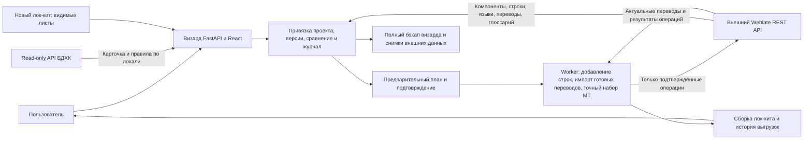

# План доработок визарда для постоянной работы с проектами и безопасного возврата

**Статус на 2026-10-04:** код задач 1–7 реализован и проверен; выпуск `release-29771e247aca` установлен на сервер БДХК после отдельного разрешения пользователя, с выключенной внешней записью. Task 8 выполнен в части сборки, свежего полного бэкапа, изолированного восстановления, установки и LAN-проверок; новый платный тест не выполнен. Существующие внешние проекты защищены от любой записи, в том числе после включения работы с новыми проектами. Фактические результаты: `docs/product/reports/2026-10-04-persistent-wizard-installation.md`.

> Для исполнителя: использовать навык `executing-plans`, выполнять задачи последовательно и отмечать шаги ниже. Делегирование допустимо только при отдельном разрешении. Согласован объём плана; реализация и новая установка этим документом ещё не объявляются начатыми.

**Дата:** 2026-10-04. **Статус:** предложенный план; весь перечисленный объём подтверждён пользователем.

**Цель:** один раз подключить или создать проект, работать с его языками и глоссарием, обновлять лок-кит без потери переводов, переводить только выбранные новые строки и иметь проверенный возврат к текущему выпуску.

**Архитектура:** существующие FastAPI, React и отдельный worker сохраняются. Визард хранит постоянную привязку к внешнему проекту, версии лок-кита, снимки строк и журнал операций. Внешний Weblate остаётся источником актуальных переводов; интеграция использует доступный REST API без установки собственного кода в Django/Celery.

**Стек:** Python >=3.12, FastAPI, Pydantic 2, HTTPX, SQLAlchemy 2, SQLite WAL; React, TypeScript, Vite, pnpm 11.19.0; systemd. Существующие ограничения и lockfile сохраняются.

**Спецификация:** исходные ограничения — `docs/product/designs/external-fastapi-wizard-scope.md`; новые согласованные требования — раздел «Пользовательский результат» этого плана. Пути к файлам ниже указаны от корня `D:\bdhc_wizard\repo`.

## Обязательные ограничения

- До установки новой версии обязателен полный бэкап текущего решения и пробное восстановление. Разработка ведётся отдельно от установленного выпуска.
- Основной API БДХК, UI карточек, read-only фасад и Telegram-бот не изменяются и не перезапускаются. БДХК используется только для чтения; штатное обновление `last_used_at` при авторизации сохраняется.
- Адрес визарда остаётся в локальной сети: `http://192.168.0.180:18511/console/`. Публикация в интернете в этот план не входит.
- Не требуются SSH-доступ к внешнему Weblate, изменения его Django/Celery, брокера, глобальных LLM-настроек или обновление сервера. Доступность отдельных операций проверяется через API; неподдерживаемые операции блокируются с объяснением.
- Скрытые и `veryHidden` листы не участвуют в анализе, импорте, переводе и экспорте. Исходная книга сохраняется отдельно без изменений.
- Подключение существующего проекта само по себе не меняет его строки, переводы, глоссарий и настройки. Запись выполняется только после просмотра и подтверждения конкретных изменений.
- Старые переводы и языки сохраняются. Удаление строк, компонентов и проектов внешнего Weblate не является частью обновления лок-кита.
- Работа над judge, автоматическим ремонтом, новым LLM-парсером, stores, split, extraction, письмами и финансовыми отчётами не включена.
- До запуска нужны короткие функциональные проверки. Нагрузочные и длительные проверки можно выполнить после запуска. Полная книга не используется для автоматической платной приёмки.

## Что есть сейчас и что требуется изменить

Проверка текущего сервера подтвердила выпуск `/opt/bdhc/weblate-wizard/releases/release-e5d2ebd6ae6b`, работающие `wizard-api`, `wizard-worker`, `wizard-backup.timer` и readiness `database: ok`, `worker: ok`. Это исходная точка возврата. Файл `shared/previous-release` сейчас указывает на более ранний `release-96ccad6031c4`; его нельзя считать бэкапом текущего выпуска.

Локальный исходный репозиторий на момент проверки имеет HEAD `3601b84`. При бэкапе отдельно фиксируются локальный Git HEAD и идентификатор установленного пакета: совпадение этих идентификаторов не предполагается.

| Возможность | Текущая реализация | Доработка |
|---|---|---|
| Несколько языков | Повторное использование собственного завершённого проекта при неизменных исходных строках | Постоянная привязка независимо от наличия завершённого задания; подключение уже существующего внешнего проекта |
| Новый лок-кит | `source_identity` требует точного совпадения; изменение источника блокирует повторное использование | Версии, сопоставление компонентов и предварительный отчёт о различиях |
| Машинный перевод | Запрос с `q: state:empty` на выбранный компонент | Ограничение точным согласованным набором новых строк; отдельный набор для нового языка |
| Экспорт | Сохранение нескольких языков при совпадающем источнике | Сборка по актуальной версии с сохранением старых языков и неизменной истории выгрузок |
| Бэкап | `backend/app/backup.py` делает согласованную копию SQLite | Дополнить файлами, выпуском, конфигурацией, секретами и проверкой восстановления |
| Откат | `deploy/rollback.sh` переключает код на `previous-release`, оставляя общие данные | Явная точка возврата, восстановление конфигурации и данных при необходимости, запрет повторных внешних операций после отката |

## Пользовательский результат

1. Пользователь вводит название. Визард ищет доступные проекты во внешнем Weblate. При совпадении показывает название, slug и ссылку; пользователь выбирает проект и подтверждает подключение. Неоднозначные совпадения не выбираются автоматически.
2. После подключения загружаются компоненты, исходный язык, существующие языки перевода, строки с текущими переводами и доступный глоссарий. Статусы показываются отдельно по каждому компоненту и языку.
3. Если исходный загруженный XLSX недоступен через API, визард предлагает восстановленный табличный снимок. Он содержит полученные ключи, контекст, исходный текст и переводы, но не обещает восстановить оформление и структуру исходной книги.
4. Пользователь загружает новый лок-кит и выбирает видимые листы. Визард показывает: совпадающие строки, новые строки, изменения исходного текста, конфликты ключей, отсутствующие в новой книге строки и новые готовые переводы.
5. Для существующего языка по умолчанию переводятся только новые строки без готового перевода. Старые пустые строки показываются отдельно и включаются лишь явным выбором. Для нового языка предлагается перевод всех выбранных исходных строк, для которых нет готового target.
6. Перед запуском видны языки, количество строк, изменения во внешнем проекте, контекст и инструкции. Пользователь может менять автоматически заполненный текст. При смене языка шаблонные вставки обновляются; ручной текст сохраняется, а противоречие выбранному языку требует исправления или подтверждения.
7. После обработки пользователь скачивает лок-кит с переводами выбранных языков. Предыдущие задания и выгрузки остаются доступными; новый язык не заменяет старый.

## Файлы и границы изменений

| Файлы | Назначение |
|---|---|
| `backend/app/integrations/weblate.py` | API чтения, нормализация ответов, проверка возможностей, строго ограниченные операции записи |
| Новые `backend/app/services/project_links.py`, `kit_versions.py`, `kit_diff.py` | Постоянная привязка, снимки и версии, сопоставление и сравнение строк |
| Новый `backend/app/routes/project_links.py`; существующие `main.py`, `schemas.py`, `routes/producer.py`, `routes/runs.py` | API поиска, подключения, предварительного сравнения и подтверждения |
| `backend/app/models.py`, `db.py`, `services/drafts.py`, `services/runs.py`, `worker.py` | Хранение новых сущностей в существующей БД, неизменные планы заданий, блокировки и восстановление |
| `backend/app/services/profiles.py`, `exports.py`; новый `services/diagnostics.py` | Контекст и инструкции, экспорт по версиям, безопасный отчёт об ошибках |
| `backend/app/backup.py`, новый `deploy/backup.sh`, существующие `deploy/install.sh`, `deploy/rollback.sh`, `scripts/package_release.py` | Полный комплект восстановления, проверка перед установкой и управляемый откат |
| `console/src/components/CreateProjectDialog.tsx`, `screens/ProjectOverview.tsx`, `screens/wizard/LocKitWizard.tsx`, `ProfileIntegration.tsx`, `types.ts`, `screens/RunCard.tsx`, `DownloadScreen.tsx` | Подключение проекта, различия лок-кита, языки, предупреждения и диагностика |
| `console/src/api/client.ts`, `generated.ts`, `contract.ts`, `locales/ru.json`, `docs/specs/openapi.yaml` | Согласованный контракт backend/UI и русские сообщения |
| `tests/`, тесты компонентов UI, `docs/product/guides/` | Небольшой набор проверок критического поведения и инструкции эксплуатации |

Новые сущности: `ProjectLink` — локальный проект, внешний slug и карта компонентов; `RemoteSnapshot` — версия наблюдаемых внешних данных; `KitVersion` — исходный файл и нормализованный manifest; `ChangePlan` — точный набор подтверждаемых операций; `OperationRecord` — намерение, ответ и результат проверки конкретной операции. Хранятся в существующей SQLite, без отдельного брокера или новой СУБД. Новые задания ссылаются на неизменный снимок плана, а не на редактируемый черновик.

## Особое внимание при проверке

- Переименование или перестановка листов не должно направлять строки в другой компонент: порядковый `kit1`, `kit2` не является постоянной привязкой.
- Одинаковый ключ с изменившимся source требует решения; исчезновение строки из книги не означает разрешение удалить её во внешнем проекте.
- Если внешний проект изменился после предварительного просмотра, затронутый набор пересчитывается и подтверждается заново.
- Неопределённый результат платного POST нельзя считать отказом и повторять без проверки; восстановление старой БД не должно повторно отправлять такой POST.
- Изменение инструкций и экспорт для одного языка должны сохранять настройки и результаты остальных языков.

## Задача 1. Зафиксировать текущий выпуск и проверить восстановление

**Файлы:** `backend/app/backup.py`, новый `deploy/backup.sh`, новый `docs/product/guides/backup-and-rollback.md`; контрольный manifest бэкапа хранится вне Git.

- [ ] Зафиксировать точный `current`, локальный HEAD, состав установленного выпуска, состояние собственных служб, пути данных, версии зависимостей и health/PID сервисов БДХК. Сохранить локальные незакоммиченные изменения, если они есть, вместе с Git bundle. Выделить рабочую ветку `codex/persistent-projects`.
- [ ] На короткое окно запретить новые задания визарда, дождаться безопасного завершения активных операций, затем остановить только его API и worker. Неподтверждённые внешние операции сначала сверить; не обрывать их ради копирования файлов.
- [ ] Сделать согласованную SQLite-копию через backup API и сохранить полный `shared/data`, оригиналы загрузок, результаты, точный каталог текущего выпуска, lockfile, `shared/wizard.env`, используемые секреты и systemd-конфигурацию. Секреты поместить в отдельную защищённую часть архива с ограниченными правами; не включать в Git или обычный отчёт.
- [ ] Сохранить комплект на сервере и вторую копию в `D:\bdhc_wizard\backups\<дата-время>`. Составить manifest с SHA-256 и версией схемы; проверить контрольные суммы и `PRAGMA integrity_check`. Дополнительно снять через API состояние только затрагиваемых внешних проектов: настройки, компоненты, строки, переводы и глоссарий. Это снимок данных, а не полный бэкап сервера Weblate.
- [ ] Развернуть копию в изолированном каталоге, проверить запуск исходного выпуска, вход, открытие проектов/истории и скачивание сохранённого файла. Внешняя сеть и worker с реальными токенами в этой проверке отключены. После проверки вернуть исходные службы и сравнить health БДХК до/после.

**Готово, когда:** комплект проверен чтением и пробным восстановлением; точка возврата — именно `release-e5d2ebd6ae6b`. При отсутствии восстановимого комплекта установка доработок запрещена. Если до установки текущий выпуск изменится, бэкап и проверка повторяются для нового фактического baseline.

## Задача 2. Подключать существующий проект после подтверждения

**Файлы:** `integrations/weblate.py`, новые `services/project_links.py`, `routes/project_links.py`, `main.py`, `schemas.py`, `CreateProjectDialog.tsx`, API-контракт. Проверка: новый `tests/test_project_links.py`.

- [ ] Ввести операции `discover_projects(name)`, `preview_connection(remote_slug)` и `confirm_connection(candidate_id, expected_snapshot_hash)`. Конкретные маршруты: поиск `/api/producer/remote-projects/`, предварительный просмотр и подтверждение `/api/producer/projects/{slug}/connection/preview/` и `/connection/confirm/`.
- [ ] Поддержать фактические формы ответов API, в том числе массивы и пагинацию. Все ссылки следующей страницы проверять на фиксированный HTTPS-host; установить пределы времени и объёма, сообщать о неполном снимке.
- [ ] Получить компоненты, языки, строки, глоссарии и необходимые права. Для чужих форматов не использовать предположение «всё является собственным PO-mono»: читать нормализованные units, контекст и связь с source unit. Зафиксировать доступность добавления исходных строк и управления переводами отдельно от возможности читать проект.
- [ ] Создать постоянную привязку только после подтверждения выбранного проекта. Проверить права пользователя визарда; запретить незаметную привязку одной внешней цели к конкурирующим локальным заданиям. Для старых собственных завершённых проектов восстановить привязку из проверенного журнала, не из совпадения названия.
- [ ] Если совпадений нет, сохранить обычное создание нового проекта. При создании внешнего проекта записать привязку сразу после подтверждения API, не ждать завершения всего перевода. Если проект появился между поиском и POST, показать конфликт и предложить подтверждённое подключение; не объявлять чужой проект своим по одному совпадению названия.
- [ ] Проверить на mock API: открытие совпавшего проекта и отмена подключения не вызывают внешних POST/PATCH/DELETE; неоднозначность требует выбора, неполная загрузка не считается полным снимком.

**Готово, когда:** пользователь подключает доступный проект, видит его языки и компоненты; внешний проект остаётся неизменным.

## Задача 3. Загружать глоссарий и сохранять настройки других языков

**Файлы:** `services/project_links.py`, `services/profiles.py`, `integrations/weblate.py`, `ProfileIntegration.tsx`, `ProjectOverview.tsx`, `locales/ru.json`. Проверка: новый `tests/test_connected_profile.py`.

- [ ] Загрузить существующие глоссарные компоненты, термины, доступные переводы и пояснения; показать источник и время снимка. Существующий глоссарий используется без повторной публикации. Возможность загрузить пользовательский глоссарий сохраняется как отдельная подтверждаемая операция.
- [ ] Показать фактический список языков проекта с различиями по компонентам. Добавление языка не удаляет прежние языки; обновление снимка не затирает локальную историю.
- [ ] Прочитать доступные project-level инструкции и настройки выбранного engine. Глобальные ключи и настройки не запрашивать для UI и не менять. Если настройки недоступны, явно обозначить это, сохранив возможность подготовить локальный профиль.
- [ ] Передавать подтверждённые persona/style и инструкции выбранных языков через поддерживаемые machinery settings; контекст строк — через поддерживаемые поля компонентов/units. Проверять сохранение чтением API. Различать доставку настроек в Weblate и доказательство их использования конкретной LLM-задачей: последнее без журналов внешнего worker может быть недоступно. Существующий механизм использования глоссария сохраняется; отдельный LLM-вызов из визарда не добавляется.
- [ ] Автозаполнение роли учитывает проект, source и выбранные targets. Шаблон обновляется при смене языка; ручная редакция сохраняется с предупреждением о возможном несоответствии. Перед PATCH показать изменение и перечень затрагиваемых языков. Объединять карту `language_instructions` с существующей, сохраняя невыбранные записи; повторно прочитать настройки перед записью и остановиться при обнаруженном конфликте.
- [ ] Проверить один сценарий: подключение проекта с немецким профилем, добавление английского и сохранение английских инструкций оставляет немецкие инструкции и переводы прежними. Не обещать атомарное устранение внешней конкурентной записи, если API не даёт conditional update.

**Готово, когда:** глоссарий и языки видны после подключения; изменение одного языка не сбрасывает остальные настройки.

## Задача 4. Сравнивать лок-кит и сохранять его версии

**Файлы:** новые `services/kit_versions.py`, `services/kit_diff.py`, существующие `services/kits.py`, `drafts.py`, `models.py`, `db.py`, `routes/producer.py`, `LocKitWizard.tsx`, `types.ts`. Проверка: новый `tests/test_kit_diff.py`.

- [ ] Сохранять оригинал загрузки, нормализованный manifest и связь с предыдущей версией. Сопоставлять листы с компонентами по постоянной карте; неоднозначное переименование или изменение состава требует выбора пользователя. Внешние unit IDs хранить отдельно от ключей книги.
- [ ] Реализовать `compare_kit(link, remote_snapshot, kit_version) -> ChangePlan`: существующие идентичные строки, новые, изменённый source при прежнем ключе, дубликаты/конфликты, отсутствующие в новой книге, готовые targets и отсутствующие targets по языкам. При отсутствии надёжного ключа не применять сомнительное сопоставление по похожести текста.
- [ ] Новые строки допускаются к добавлению; неизменные не перезаписываются; изменённые и конфликтующие строки исключаются до решения. Отсутствующие в новой книге остаются во внешнем проекте. Не пустые внешние targets не заменяются данными новой книги автоматически.
- [ ] Показать счётчики и причины по каждому листу, с переходом к снятию галочки. Разделить «старые пустые строки» и «новые пустые строки». Не включать скрытые листы даже при наличии старых ссылок в черновике.
- [ ] Проверить одним компактным набором: новый ключ, изменённый source, удалённая из книги строка, перестановка листов и скрытый лист. Повторная загрузка идентичного файла даёт нулевой набор внешних изменений.

**Готово, когда:** пользователь до запуска видит точный перечень изменений и может исключить проблемные листы; старые данные сохраняются.

## Задача 5. Применять только подтверждённые изменения

**Файлы:** `services/runs.py`, `worker.py`, `integrations/weblate.py`, `routes/runs.py`, модель журнала операций. Проверки: расширить `tests/test_run_resume.py`, `test_weblate_client.py`, `test_seed_file.py`.

- [ ] Перед выполнением проверить актуальность снимка затронутых строк и настроек; при изменении извне пересчитать план и запросить новое подтверждение в UI. Ограничить одновременно выполняющиеся записи по внешнему проекту, включая задания с неизвестным результатом.
- [ ] Проверить штатную возможность добавления source units для каждого компонента: права, `manage_units`/`edit_template`, формат и поддерживаемый API. Если компонент не допускает добавление строк, объяснить ограничение и заблокировать этот участок. Не создавать подменный компонент и не менять настройки чужого проекта автоматически.
- [ ] Сохранять намерение каждой операции до отправки. Добавлять только согласованные новые строки с ключами и поддерживаемыми полями контекста; после ответа проверять наличие и готовность units. Готовые переводы новых строк загружать до MT, затем сверять фактический результат.
- [ ] Вместо общего `state:empty` строить запрос по точному согласованному набору unit IDs и языку. До MT сверять, что запрос выбирает именно этот набор. Синтаксис поиска и ограничения длины проверить на фактическом внешнем API; разбивать набор на ограниченные части. Если точное ограничение невозможно, запуск блокируется, расширение до всех пустых строк не допускается.
- [ ] Для нового языка набор включает выбранные исходные строки без готового target; для старого — новые пустые строки, а старые пустые только при явном включении. Перед POST показать количество. Проверить отсутствие повторной оплаты при timeout, повторном нажатии и перезапуске worker на mock API.

**Готово, когда:** одинаковый запуск идемпотентен; старые переводы не перезаписываются, перевод выполняется в подтверждённых границах. Ограничения чужого компонента показываются до внешней записи.

## Задача 6. Сделать состояние операций и ошибки понятными

**Файлы:** новый `services/diagnostics.py`, `integrations/weblate.py`, `worker.py`, `services/runs.py`, `RunCard.tsx`, `LocKitWizard.tsx`, `locales/ru.json`. Проверки: расширить `tests/test_run_resume.py`.

- [ ] Для каждой операции сохранять correlation ID, время, этап, лист/компонент, язык, HTTP-код и безопасную выдержку ответа. Токены, Authorization, пароли и ключи исключать; полный текст игры не включать в стандартный диагностический файл.
- [ ] Различать очередь, обработку, ожидание подтверждения, подтверждённый отказ, конфликт, отсутствие прав и завершение. HTTP 400 показывать вместе с безопасной причиной; timeout не приравнивать к отказу.
- [ ] Кнопка «Продолжить» сначала делает GET-проверку предыдущей операции. Для неизвестного результата MT она не повторяет POST автоматически. Если проверить завершение через доступный API нельзя, показывать непроверенное состояние и доступные действия, не объявлять успех по одному факту наличия частичных переводов.
- [ ] Показывать проблему по конкретному листу и возможность исключить его в следующем плане. Изменение уже запущенного задания создаёт новый план для оставшихся шагов, не переписывая прежний журнал.
- [ ] Добавить скачивание диагностического отчёта с проверкой доступа. Проверить 400, timeout и частичный результат, включая отсутствие секретов. Честно отделять данные визарда/API от недоступных логов Django/Celery внешнего сервера.

**Готово, когда:** пользователь видит место и причину остановки и безопасный следующий шаг; диагностический файл можно передать разработчику.

## Задача 7. Собирать лок-кит с сохранением языков и истории

**Файлы:** `services/exports.py`, `services/kit_versions.py`, `ProjectOverview.tsx`, `DownloadScreen.tsx`. Проверки: расширить `tests/test_export_history.py`, `test_kit_roundtrip.py`.

- [ ] Собирать результат по конкретной версии лок-кита и актуальным targets внешнего проекта. Объединять языки через постоянные идентификаторы строк, а не через требование совпадения всей книги с прежним manifest.
- [ ] Сохранять выбранные существующие языки и добавлять новые колонки без замены старых. Старые скачиваемые результаты остаются неизменными. Ошибки, пустые targets и конфликтующие строки включать в отдельный отчёт; отсутствие в текущей книге не должно терять внешнюю строку.
- [ ] Для подключённого проекта без оригинала книги дать экспорт восстановленного снимка с явной пометкой происхождения. Не обещать исходные формулы, оформление, порядок листов и потерянные метаданные.
- [ ] Проверить сценарий «исходный русский → немецкий; обновление с двумя новыми строками; добавление английского»: немецкие готовые targets и предыдущая выгрузка сохраняются, новая выгрузка содержит оба языка. Проверить round-trip ключей, тегов, переменных и разделителей.

**Готово, когда:** обновление лок-кита и добавление языка не затирают прежние переводы; происхождение каждого экспортируемого файла понятно.

## Задача 8. Проверить весь поток и установить с возможностью возврата

**Файлы:** `deploy/install.sh`, `deploy/rollback.sh`, `deploy/backup.sh`, `scripts/package_release.py`, `docs/product/guides/backup-and-rollback.md`; отчёт установки в `docs/product/reports/`.

- [ ] Выполнить существующие backend-проверки и новые компактные сценарии, frontend tests/typecheck/build, lint изменённых файлов. Пример команд: `uv run pytest tests`, `uv run ruff check backend tests`, `uv run ruff format --check backend tests`, `pnpm --dir console test`, `pnpm --dir console typecheck`, `pnpm --dir console build`. Не подменять эти результаты обещанием «все тесты пройдут».
- [ ] Для реальной приёмки использовать выделенный `тест — <короткий ID>`: 5–10 строк, два небольших изменения книги и добавление языка. Действующие игры, включая Dead Shell, использовать только для чтения и проверки подключения. Платный объём и язык подтвердить перед новым платным тестом; полную книгу не запускать.
- [ ] Перед установкой повторить обязательный бэкап актуального baseline. Новую сборку и совместимость БД проверить на копии; переключение `current` выполнять только после проверки. В установщик добавить запрет установки без проверенного бэкапа и безопасного состояния заданий.
- [ ] Доработать существующий `rollback.sh`: принимать явный проверенный выпуск и manifest, проверять нахождение путей внутри каталога визарда, восстанавливать требуемую конфигурацию собственных служб. Запретить неявный выбор случайного `previous-release`. Для отката только кода подтвердить совместимость схемы; для полного восстановления остановить только службы визарда и восстановить согласованный комплект БД и файлов.
- [ ] Отрепетировать откат на изолированной копии. При реальном откате сначала сохранить состояние после обновления, включая журнал внешних операций. Если уже были записи во внешний Weblate, worker после восстановления не запускается на отправку: сначала сверяются текущие внешние данные и перенесённый журнал, затем снимается блокировка. Восстановленная старая БД не является основанием повторить MT.
- [ ] После явного разрешения установки обновить только визард, проверить LAN-вход, readiness, историю, скачивание и неизменность health/PID БДХК. При сбое запуска до внешних операций вернуть baseline; после внешних операций сначала запретить дальнейшие записи и выполнить сверку. Записать идентификатор выпуска, бэкапа и фактические результаты приёмки.

**Готово, когда:** новый поток принят на коротком примере, действующие сервисы БДХК сохранены, возврат к baseline отрепетирован и описан. Нагрузочные проверки не блокируют этот этап.

## Что именно можно вернуть

Полный бэкап позволяет восстановить код, UI, локальную БД, загруженные файлы, выгрузки и конфигурацию визарда до выбранной точки. Для возврата не нужно менять основной сервис БДХК.

Локальный откат не отменяет добавление строк или выполненный перевод во внешнем Weblate. Поэтому план исключает автоматическое удаление внешних данных и требует сверки журнала перед возобновлением worker. Снимки внешних данных помогают увидеть изменения и подготовить адресное восстановление, но не заменяют серверный бэкап Weblate и не дают права откатывать чужие проекты.

## Порядок выполнения и итоговая приёмка

Порядок: **бэкап и пробное восстановление → подключение существующего проекта → языки и глоссарий → сравнение версий → ограниченная запись и MT → диагностика → экспорт → приёмка и установка**. Проверки каждого шага выполняются по ходу работы; окончательная приёмка объединяет их в один короткий сценарий.

Результат принимается, если существующий проект подключается без записи, новый лок-кит добавляет только подтверждённые новые строки, новый язык не удаляет старый, повторный запуск не дублирует внешние операции, проблемный лист можно исключить, файл скачивается с сохранёнными ключами и языками, а текущий baseline можно восстановить из проверенного комплекта.
