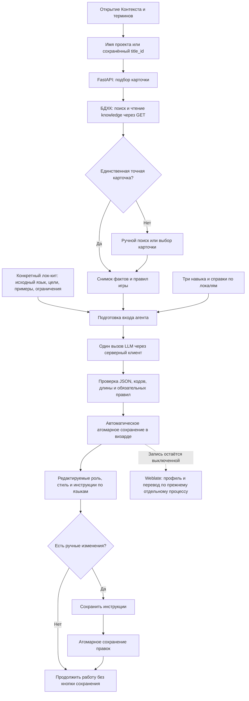

# План: автоподбор карточки и агент подготовки инструкций

> **For agentic workers:** REQUIRED SUB-SKILL: Use executing-plans to implement this plan task-by-task in the current session. Steps use checkbox syntax for tracking. No subagent dispatch is required.

**Статус:** согласован; локальная реализация задач 1–5 завершена. Контракты, тесты и служба задач 6–7 реализованы; ключ предоставлен, три контрольных запроса GPT-6 Luna успешно выполнены локально. Независимая языковая оценка ещё не выполнена. Задача 8 не выполнялась: отдельное разрешение установки этого выпуска ещё не получено. Работающий сервер и внешний Weblate не изменялись. Последний отчёт: docs/product/reports/2026-10-05-02-profile-agent-openrouter.md; первоначальный выпуск: docs/product/reports/2026-10-05-profile-agent-local-release.md.

**Goal:** Автоматически заполнять контекст и редактируемые инструкции переводчика из карточки БДХК и точных языков текущего лок-кита, сохраняя ручные правки.

**Architecture:** React запрашивает подбор карточки через FastAPI. Backend готовит ограниченный снимок фактов и выполняет одного агента с тремя версионированными пакетами инструкций через существующий LLM-клиент. Проверенный результат автоматически сохраняется целиком в визарде и заполняет редактируемую форму. Кнопка сохранения нужна только после ручных изменений. Внешний Weblate в этом изменении остаётся доступен только для чтения.

**Tech Stack:** существующие React/TypeScript, FastAPI, Pydantic, SQLAlchemy/SQLite, httpx; существующая серверная конфигурация OpenRouter/LiteLLM. Дополнительные LangChain, Celery, Redis и агентский SDK не нужны.

**Spec:** запрос пользователя от 2026-10-05 и `docs/product/research/2026-10-05-profile-agent-skills.md`.

## Выбранная LLM и подключение

Уточнение владельца от 2026-10-05 заменяет первоначальный выбор GPT-5.4 mini: использовать **GPT-6 Luna**, если её тариф в OpenRouter ниже GPT-5.4 mini и подключение успешно; иначе **DeepSeek V4 Flash**. Проверенный каталог: Luna $0.10/$0.50, mini $0.75/$4.50 за миллион входных/выходных токенов. Luna дешевле по обоим тарифам; три разрешённых контрольных вызова прошли. DeepSeek не потребовался.

Модель: `openai/gpt-6-luna`, версия каталога `openai/gpt-6-luna-20260922`. [OpenRouter](https://openrouter.ai/openai/gpt-6-luna) и [официальная документация OpenAI](https://developers.openai.com/api/docs/models/gpt-6-luna) подтверждают выбранную модель; фактический клиент проверен со строгой JSON-схемой, reasoning low и max_completion_tokens 16384. Инструменты, temperature и список запасных моделей не передаются.

```dotenv
PROFILE_LLM_BASE_URL=https://openrouter.ai/api/v1
PROFILE_LLM_MODEL=openai/gpt-6-luna
PROFILE_LLM_MODEL_VERSION=openai/gpt-6-luna-20260922
PROFILE_LLM_TOKEN_FILE=/opt/bdhc/weblate-wizard/shared/secrets/profile-llm-token
PROFILE_LLM_REASONING_EFFORT=low
PROFILE_LLM_MAX_COMPLETION_TOKENS=16384
PROFILE_LLM_APP_TITLE=HCGameLoc Wizard - Translation Profile Agent
PROFILE_LLM_HTTP_REFERER=http://192.168.0.180:18511/console
WIZARD_PROFILE_AGENT_ENABLED=0
WIZARD_EXTERNAL_WRITES=0
```

`X-OpenRouter-Title` указывает конкретный сервис подготовки профиля, `HTTP-Referer` — фактический URL визарда. Их серверные настройки проверяются; LiteLLM эти заголовки не получает. Ключ предоставлен владельцем в закрытом локальном файле, проверен без вывода содержимого; ключ не входит в Git/ZIP/браузер/журнал.

Локальная проверка: три синтетические карточки, пять локалей zh_Hans/zh_Hant/ja/pt_BR/es_MX, всего три запроса без повторов. Автосохранение, точные коды и повторное использование задания подтверждены. Четвёртая конфликтная карточка блокируется локально и в LLM не отправляется. Отчёт: docs/product/reports/2026-10-05-02-profile-agent-openrouter.md. Смысл результатов просмотрен реализатором; независимая языковая оценка и реальная эксплуатация не заменяются этой малой выборкой.

Корпоративный LiteLLM не подключался. Визард не наследует ключи Weblate. DeepSeek разрешён только по указанному владельцем условию, без скрытой смены модели после неизвестного результата. Настройки модели и версии входят в ключ генерации.

Установка и включение на сервере остаются задачей 8 после отдельного разрешения и полного приватного бэкапа работающего решения. До установки пример конфигурации оставляет агент и внешнюю запись выключенными.

## Обязательные требования

- При единственном точном совпадении имени проекта с подтверждённым названием/алиасом игры контекст подтягивается автоматически. Нормализация: Unicode NFKC, регистр, пробелы. Сходство по подстроке не считается совпадением.
- Если проект уже связан с `title_id`, использовать связь, а не угадывать игру заново. При отсутствии точного совпадения доступны ручной ввод названия/ссылки, Enter, кнопка «Найти карточку» и выбор результата.
- Отдельное поле «Роль игрока» убрать из формы. Старое `player_role` сохранить в данных и совместимости API; оно не должно стать обязательным.
- Заголовок блока ровно: **«Готовые инструкции переводчику - если не уверены не меняйте»**. Старую подсказку о последовательном сохранении анкеты/инструкций и надпись «Профиль перевода ещё не готов» убрать. Ошибки и процесс подготовки показывать отдельно понятным текстом.
- Агент заполняет «Роль переводчика», «Стиль перевода» и «Инструкции для языка» для всех выбранных целей. Поля остаются редактируемыми.
- Уточнение пользователя: предзаполненные роль, стиль и языковые инструкции сохраняются автоматически. Если пользователь их не менял, нажатие «Сохранить инструкции» не требуется; после подтверждённого сохранения форма позволяет продолжить работу. Кнопка доступна только при несохранённых ручных изменениях и отключается после их успешного сохранения.
- Имя игры берётся из выбранной карточки; локальное название проекта хранится отдельно. Для `Test_API_LOC`, связанного с Dead Shell, агент не должен описывать `Test_API_LOC` как название игры.
- Никакого жёсткого жанра приключения/головоломки, обязательного юмора или «сказочной атмосферы» без основания в карточке.
- Точные коды сохраняются: `zh_Hans` и `zh_Hant`, `pt` и `pt_BR`, `es` и `es_MX` — разные цели. Нормализация поиска не меняет коды записи/API.
- Одна подготовка на неизменный набор входных данных. Обновление страницы не запускает повторный оплачиваемый запрос.
- Источник/цели берутся из конкретного `upload_token` и его ревизии, не из «последнего черновика проекта».
- Подтягивание и агент заполняют только пустые/автоматические поля; ручные поля требуют явного выбора для замены.
- Существующие проекты, переводы, глоссарии и настройки внешнего Weblate не изменять. `WIZARD_EXTERNAL_WRITES=0` сохраняется.
- До установки создать полный бэкап с текущим UI patch `c31769638252`, проверить возврат на копии. Разрешение на предыдущий UI fix не является разрешением установки этого нового выпуска.

## Схема реализованной локальной работы



Пунктир здесь обозначает недоступную при текущем режиме запись во внешний Weblate. Подготовка профиля и запуск перевода — разные операции.

## Откуда берётся содержимое полей

| Поле формы | Источник и преобразование |
|---|---|
| Название игры или ссылка | Автоматически название проекта; при расхождении — ввод пользователя. Это запрос поиска, а не доказательство связи с игрой. |
| Карточка | Единственное точное соответствие или выбор пользователя; сохраняются `title_id`, версия схемы, `context_hash`, название игры. |
| Жанр | Коды и уточнение жанра карточки; краткое представление, без дополнения LLM выдуманными жанрами. |
| Сеттинг и роль игрока | Сеттинг/эпоха и относящиеся к ним факты брифа. Отдельного поля «Роль игрока» больше нет. |
| Аудитория | Подтверждённая аудитория карточки. |
| Стиль интерфейса/диалогов, ненормативная лексика | Соответствующие правила карточки с учётом ручных переопределений. Не навязывать один регистр всем персонажам. |
| Роль переводчика | Навыки `game-context-brief` + `weblate-profile-author`: настоящая игра, исходный язык, цели, фактический жанр и контекст. |
| Стиль перевода | Навык `weblate-profile-author`: голос игры, аудитория, UI/диалоги, персонажи, терминология и ограничения движка. |
| Инструкции для языка | Навык `game-locale-instructions`: точный код, языковые справки, локальные правила БДХК и ручные правила. |

## Контракты и файлы

Добавить закрытые Pydantic-модели в `backend/app/schemas.py`:

- `ContextResolveRequest(revision, upload_token, query=None, title_id=None)`.
- `ContextResolution(state, matches, snapshot_id, title, answers, locale_rules, warnings)`, где `state` — `matched`, `choice_required`, `not_found`.
- `ProfileGenerationInput(project_slug, project_name, game_title, source_language, target_languages, upload_token, upload_revision, profile_revision, context_snapshot_id, context_hash, answers, locale_rules, evidence, protected_tokens, skills_version, locale_rules_version)`.
- `ProfilePrepareRequest(revision, upload_token, upload_revision, context_snapshot_id, answers)`; модель и endpoint клиент не передаёт.
- `ProfileGenerationJob(job_id, input_key, state, result, warnings, auto_saved, profile_revision)`, состояния `queued`, `running`, `ready`, `failed`, `unknown`, `stale`. `ready` означает проверенный и сохранённый результат, `auto_saved=true` и ревизия подтверждают запись backend.
- `ProfileCommitRequest(revision, upload_token, upload_revision, job_id=None, answers, generated, edited_fields)`; `generated` — существующий `TranslationProfile`.

Поля `persona`/`style` по прежнему максимум 4000 символов, инструкция одного языка — 1000. Добавить к входу серверные сведения о модели/версии валидатора при расчёте `input_key`; секреты в него не входят. Ревизии используются для защиты от устаревших результатов; само увеличение ревизии при автосохранении не меняет смысловой ключ и не запускает генерацию заново. Снимки/задания принадлежат владельцу проекта.

| Файл | Назначение |
|---|---|
| `backend/app/integrations/bdhc.py` | Возвращать данные игры, которые сейчас отбрасываются в `read_profile`; точный подбор и каноническое имя. |
| новый `backend/app/services/profile_context.py` | Снимки карточки, отбор фактов, привязка к черновику и объединение с ручными полями. |
| новые `backend/app/skills/*/SKILL.md`, `backend/app/skills/game-locale-instructions/references/locales.json` | Три собственных навыка, версия и краткие справки. |
| новый `backend/app/services/profile_agent.py` | Подготовка входа, компоновка навыков и проверка результата. |
| новый `backend/app/services/profile_jobs.py`, `backend/app/profile_worker.py` | Надёжная очередь подготовки профилей, дедупликация и обработка без блокирования API. |
| `backend/app/integrations/llm.py`, `profile.txt` | Расширенный явный вход и запрос по существующему клиенту. |
| `backend/app/routes/bdhc.py`, `profiles.py`, `services/profiles.py`, `main.py`, `settings.py` | Новые endpoints, сохранение целого профиля, версия и включение функции. |
| `console/src/screens/wizard/ProfileIntegration.tsx`, новый `useProfilePreparation.ts`, `LocKitWizard.tsx` | Автоподбор, подтверждение автосохранения, защита ручного текста, кнопка только для ручных изменений. |
| `docs/specs/openapi.yaml`, `console/src/api/client.ts`, `generated.ts`, `locales/ru.json`, `gettext-catalog.js` | Синхронный API-контракт и надписи. |
| новый `deploy/wizard-profile-worker.service`, существующие `deploy/install.sh`, `backup.sh`, `rollback.sh`, `environment.example` | Управление дополнительной службой и её безопасный возврат. |

## Review Focus

1. Название проекта отличается от названия игры; есть похожие и повторяющиеся названия — связь никогда не выбирается по одному только сходству.
2. Пользователь редактирует поле, пока агент работает, или приходит ответ от предыдущей карточки — его текст и текущая карточка сохраняются.
3. В проекте два черновика с разными языками; между вкладками меняется источник — генерация использует только указанную версию.
4. LLM отключён, недоступен, вернул неверный JSON или процесс упал после отправки — старый профиль остаётся, повторная оплата не запускается автоматически.
5. Карточка неполная, правила нескольких профилей противоречат, `zh_Hant` не задаёт регион — агент не выдумывает недостающие факты и не выбирает спорный вариант молча.

## Задача 1. Снимок контекста и точная привязка к игре

**Файлы:** `schemas.py`, `integrations/bdhc.py`, `services/profile_context.py`, `routes/bdhc.py`; `tests/test_bdhc.py`, новый `tests/test_profile_context.py`.

**Interfaces:** `resolve_context(store, settings, owner, slug, body: ContextResolveRequest) -> ContextResolution`; `get_context_snapshot(store, owner, slug, snapshot_id) -> dict`.

- [x] Написать тесты: один точный результат заполняет контекст; один похожий результат не привязывается; несколько точных требуют выбора; выбранный `title_id` имеет приоритет; ручной ввод/ссылка разрешаются; чужой/истёкший черновик и неверная ревизия отвергаются.
- [x] Проверить ожидаемое падение: `python -m pytest tests/test_profile_context.py tests/test_bdhc.py`.
- [x] Реализовать функции и POST `/projects/{slug}/context/resolve/`. Нормализовать только для сравнения. Если API не отдаёт подтверждённый алиас, не изобретать его удалением подзаголовка. Сохранять ограниченный снимок брифа, глобальных/локальных правил, голосов и происхождения; все обращения к БДХК — GET.
- [x] Ограничить снимок 24000 символами JSON. При превышении сокращать необязательные примеры, явно сообщать об исключённых данных; обязательные правила не обрезать молча. Поддерживать текущую схему `12.7`; иную показывать как неподдерживаемую.
- [x] Повторить тесты. Зафиксировать `feat(profile): resolve game context for exact project matches`.

## Задача 2. Три встроенных навыка и справки по языкам

**Файлы:** `backend/app/skills/`; новый `services/profile_agent.py`; новый `tests/test_profile_agent.py`; исследование навыков.

**Interfaces:** `build_profile_input(store, owner, slug, request: ProfilePrepareRequest) -> ProfileGenerationInput`; `load_profile_skills() -> tuple[str, str]` возвращает содержимое и его хеш; `validate_agent_result(value, input: ProfileGenerationInput) -> TranslationProfile`.

- [x] Написать тесты на сценарии Dead Shell / Lord Ambermaze / неизвестная игра: нет общего навязанного жанра; название игры и проекта различены; источники/цели взяты из заданного токена. Для `zh_Hans`/`zh_Hant`, `pt`/`pt_BR`, `es`/`es_MX` справки не сливаются.
- [x] Запустить тест до реализации: `python -m pytest tests/test_profile_agent.py`.
- [x] Написать узкие навыки по исследованию и справки для 14 перечисленных кодов. Записать источники/версии справок; проверить сами документы языковых руководств перед использованием. Для остальных кодов явно отмечать отсутствие проверенной локальной справки, сохраняя точный код.
- [x] Обязательные правила добавлять кодом после ответа модели: факты и механика не меняются, утверждённая терминология соблюдается, теги/плейсхолдеры/числа/разделители сохраняются. Результат сверх лимита или с пропущенными целями отвергать, не обрезать.
- [x] Приоритет правил: ограничения движка → явные правки пользователя → подтверждённые правила игры → языковой справочник → предложение LLM. Конфликт с ограничением движка возвращается отдельной ошибкой.
- [x] Повторить тесты. Зафиксировать `feat(profile): add game context and locale authoring skills`.

## Задача 3. Контролируемый вызов LLM и очередь подготовки

**Файлы:** `integrations/llm.py`, `profile.txt`, `services/profile_agent.py`, `services/profile_jobs.py`, `profile_worker.py`, `settings.py`; новый `tests/test_profile_jobs.py`, `tests/test_access.py`.

**Interfaces:** `generate_profile_from_input(settings, input: ProfileGenerationInput) -> dict`; `prepare_profile(store, settings, owner, slug, body: ProfilePrepareRequest) -> ProfileGenerationJob`; `get_profile_job(store, owner, slug, job_id) -> ProfileGenerationJob`; `process_profile_once(store, settings, generator=generate_profile_from_input) -> bool`.

- [x] Тесты: одинаковый `input_key` возвращает одно задание; смена карточки/языка/правил/модели/навыка меняет ключ; параллельные запросы не запускают два вызова; увеличение ревизии при автосохранении не запускает повторный запрос после обновления страницы. Неверный JSON, лишний код, пропущенный язык, пустой текст и длина >1000 отвергаются. Проверить таймаут и падение после отправки: состояние `unknown`, без автоматического повторного запроса.
- [x] Запустить тесты до реализации: `python -m pytest tests/test_profile_jobs.py tests/test_profile_agent.py tests/test_access.py`.
- [x] Хранить задания в существующем `Record` с отдельным kind `profile_generation`, идентификаторами `profile-generation:<uuid>` и CAS-переходами через ревизии. Атомарно резервировать `input_key` в отдельной индексной записи в одной транзакции. У одного владельца одновременно один активный запрос генератора.
- [x] Отдельная служба обрабатывает очередь; задания перевода и существующий `worker.py` не менять. Перед сетевым вызовом зафиксировать `dispatch_started`; таймаут 120 секунд, lease 180 секунд. После истёкшей lease с отмеченной отправкой сохранять `unknown`; безопасно вернуть в очередь только задания до отправки. Результат принять только для совпадающей версии входа.
- [x] Компоновка запроса: системные инструкции + три навыка; JSON данных карточки/анкеты/языков/ограниченных примеров как данные. Содержимое карточки не может назначать инструменты, endpoint или системные правила. У агента нет shell и токена записи Weblate.
- [x] Данные примеров брать только из выбранных листов и исходной колонки: максимум 10 строк, 1000 символов на пример. Ограничения движка брать из подтверждённых настроек проекта и детерминированного анализа выбранных листов; присутствие токенов в десяти примерах не доказывает отсутствие других токенов в лок-ките. Сохранять правила разметки и подстановок явно. Не отправлять целиком лок-кит, секреты или лишние данные карточки.
- [x] Оставить существующие разрешённые endpoints; сервер выбирает `PROFILE_LLM_*`. Реализовать настройки выбранной модели, reasoning и лимита из раздела подключения; покрыть сериализацию параметров и отказ при `finish_reason=length` тестами. Добавить `WIZARD_PROFILE_AGENT_ENABLED`, по умолчанию `0`. При отсутствии ключа/модели возвращать `profile_agent_not_configured`, сохраняя редактируемый вариант из фактов и базовых правил без выдуманного жанра.
- [x] Повторить тесты и зафиксировать `feat(profile): prepare instructions through a durable bounded agent`.

## Задача 4. Сохранение и защита пользовательских правок

**Файлы:** `routes/profiles.py`, `services/profiles.py`, `schemas.py`, `services/runs.py`; новый `tests/test_profile_commit.py`, `tests/test_connected_profile.py`.

**Interfaces:** POST `/projects/{slug}/profile/prepare/`, GET `/projects/{slug}/profile/preparations/{job_id}/`, POST `/projects/{slug}/profile/commit/`; `commit_profile(store, owner, slug, body: ProfileCommitRequest, engine) -> dict` для ручных правок; `commit_prepared_profile(store, owner, slug, job_id) -> dict` для проверенного результата задания.

- [x] Тесты: целый подготовленный профиль сохраняется без POST от пользователя; профиль и состояние задания `ready` записываются одной транзакцией; закрытие вкладки не препятствует автосохранению; повторное завершение задания не создаёт вторую запись. Неверная/устаревшая ревизия ничего не меняет; сбой генератора или сохранения не очищает старые инструкции и не даёт статус `ready`; добавление языка сохраняет прочие языки и ручной стиль; legacy `player_role` остаётся. Между вкладками текущий источник не подменяется.
- [x] Проверить падение: `python -m pytest tests/test_profile_commit.py tests/test_connected_profile.py`.
- [x] Хранить источник каждого поля: `manual`, `bdhc`, `agent`, `template`; отдельные записи по языкам, версия генерации и входной ключ. Старые профили без метаданных считать ручными для защиты от перезаписи.
- [x] После проверки результата worker вызывает `commit_prepared_profile`: сохраняет анкету и автоматические инструкции с защитой ревизии, сохраняя ручные поля, затем возвращает сохранённую ревизию. При конфликте результат становится `stale`, а не перезаписывает новую версию. Повтор сохранения уже полученного результата не вызывает LLM. Проверенный базовый вариант при отключённой LLM сохраняется тем же локальным механизмом с источником `template`, без обозначения его результатом агента.
- [x] Новое сохранение принимает анкету и инструкции одновременно. При включённом `WIZARD_PROFILE_AGENT_ENABLED` обычное сохранение анкеты не вызывает LLM синхронно; автоматическая генерация идёт новым отдельным путём. При выключенном флаге сохранить прежний API-контракт и поведение для старого UI; проверить оба режима тестами. Проверка запуска берёт контекст конкретного черновика и не считает неуспешный результат готовым.
- [x] Новые цели должны иметь отдельные непустые инструкции перед использованием агентского результата. Для невыбранных ранее сохранённых языков данные остаются в локальном хранилище и не уходят в запрос текущего запуска.
- [x] Повторить тесты. Зафиксировать `feat(profile): commit prepared instructions without losing manual edits`.

## Задача 5. Форма с автоматической загрузкой и редактированием

**Файлы:** `ProfileIntegration.tsx`, новый `useProfilePreparation.ts`, `LocKitWizard.tsx`; `ProfileIntegration.test.tsx`, `LocKitWizard.test.tsx`, новый `ProfilePreparation.test.tsx`.

**Interfaces:** hook `useProfilePreparation({api, slug, projectName, uploadToken, uploadRevision, profile, source, targets})` возвращает разрешение карточки, состояние/результат подготовки, локальные поля и действия поиска/повторной подготовки/сохранения. Методы API определены задачей 4.

- [x] Тесты: точное совпадение заполняет форму без кнопки поиска; предзаполненные инструкции уже сохранены, переход дальше не требует кнопки; кнопка отключена без изменений, включается после ручной правки и отключается после успешного сохранения. Ошибка сохранения не показывает успешный статус. Другое название доступно вручную по Enter и кнопке; неоднозначность требует выбора; поздний ответ старой карточки игнорируется; ввод во время генерации сохраняется; новое поле языка появляется автоматически, ручные прочие поля не сбрасываются.
- [x] Запустить до реализации: `pnpm --dir console exec vitest run src/screens/wizard/ProfilePreparation.test.tsx src/screens/wizard/ProfileIntegration.test.tsx src/screens/wizard/LocKitWizard.test.tsx`.
- [x] При первом входе автоматически разрешить карточку. Новый проект получает автоматические значения; у существующего ручные значения защищены. Автоподготовка запускается только при сохранённых языке-источнике/целях и разрешённой карточке; повторное открытие использует кеш задания.
- [x] Отмечать dirty-поля при вводе, применять результат только к неизменённым полям. Действие «Подготовить заново» показывает изменения защищённых полей и позволяет выбрать заменяемые поля; смена карточки/источника не оставляет старые инструкции молча актуальными.
- [x] Готовность брать из подтверждённого backend автосохранения, не из одного факта заполнения textarea. После него показать «Инструкции сохранены автоматически» и разрешить переход дальше. Если пользователь менял текст во время генерации, сохранить его в форме как несохранённую правку; не выдавать автосохранённый вариант за сохранение этих правок. Переход с ручными несохранёнными правками требует их сохранения или явного отказа от них.
- [x] Убрать отдельный input «Роль игрока», старые подписи/статус и жёсткий шаблон жанра. Поставить указанный заголовок. В процессе — «Подготавливаем инструкции…»; при сбое — конкретная ошибка и возможность ручного ввода. Кнопка «Сохранить инструкции» сохраняет анкету и тексты вместе только после ручных изменений; сама генерацию не запускает.
- [x] Проверить клавиатуру, подписи, фокус ошибок, статус подготовки, длинные названия и экран 390 px. Пользователь видит название выбранной игры и происхождение заполнения.
- [x] Повторить тесты. Зафиксировать `feat(console): autofill game context and editable translation instructions`.

## Задача 6. Контракт API и контроль качества

**Файлы:** `docs/specs/openapi.yaml`, `client.ts`, `generated.ts`, `locales/ru.json`, `gettext-catalog.js`; `tests/test_profile_agent.py`, API-тесты, новый `analysis/profile-agent-eval/README.md`, обезличенные fixtures.

- [x] Согласовать новые request/response-модели с API-клиентом и регенерировать типы: `pnpm --dir console api:generate`, `pnpm --dir console i18n:generate`.
- [x] Добавить контрольные карточки: Dead Shell, Lord Ambermaze, игра без контекста, противоречивые правила, две игры с одинаковым именем, разные черновики одного проекта. Использовать разрешённые/обезличенные факты; не сохранять полные приватные выгрузки в Git.
- [x] На заглушках прогнать коды всех 14 справок и редкую локаль. На реальной LLM выполнить ограниченную оценку только после настройки и отдельного разрешения на пробные вызовы: 3 карточки с различными профилями и локально блокируемая конфликтная карточка; 5 целевых локалей (`zh_Hans`, `zh_Hant`, `ja`, `pt_BR`, `es_MX`) в каждом запросе, максимум 4 запроса без автоматических повторов.
- [ ] Проверить: 100% соответствие схемы и кодов; отсутствие выдуманных фактов; обязательные правила движка; соответствие карточке; различение вариантов языка; ёмкость текста; сохранение ручных правок. Для проверенных кейсов ноль критических ошибок. Качество содержимого оценить отдельно от синтаксической проверки, используя категории `weblate-lqa` без запуска аудита/записи Weblate.
- [x] Полная проверка: `python -m pytest`, `ruff check backend/app tests`, `pnpm --dir console test`, `pnpm --dir console typecheck`, `pnpm --dir console build`, `git diff --check`. Обновить руководство формы/настроек и отчёт проверки. Зафиксировать `test(profile): verify game and locale instruction generation`.

## Задача 7. Служба, настройка, бэкап и выпуск

**Файлы:** `deploy/wizard-profile-worker.service`, `deploy/install.sh`, `backup.sh`, `rollback.sh`, `preflight.py`, `environment.example`; `tests/test_deploy_contract.py` (если отсутствует — создать); `docs/product/guides/deployment.md`.

- [x] Тесты на копиях: новая служба и флаг учитываются в установке/остановке/бэкапе/возврате; возврат старого выпуска прекращает генератор; задания после неизвестной отправки не повторяются. Полный бэкап включает работающий UI patch, данные, конфигурацию и очередь.
- [x] Добавить отдельную службу генератора с тем же непривилегированным пользователем и ограничениями, что у визарда. Включение генератора отделить от `WIZARD_EXTERNAL_WRITES`.
- [x] Проверить совместимость старой версии с дополнительными Record-kind на изолированной копии данных. Сценарий отката: остановить генератор, сохранить состояние после обновления, вернуть код/настройки; при необходимости вернуть полную копию базы. Незавершённый внешний LLM-запрос пометить для ручной сверки.
- [x] Подготовить локальное подключение GPT-6 Luna через OpenRouter согласно разделу подключения: закрытый файл ключа, точный код модели и параметры, проверка доступа/баланса и разрешённый пробный вызов со строгой схемой. Проверить успешное автосохранение всех выбранных языков; лишь после этого разрешить флаг агента. Ключ и модель проверены локально; установка ключа и включение на работающем сервере остаются задачей 8. LiteLLM допускается только при проверенной доступности той же модели, без скрытой подмены.
- [x] Подготовить ZIP, контрольные суммы, source bundle, тестовый отчёт и инструкцию возврата. Зафиксировать `feat(deploy): manage profile preparation worker and rollback`.

## Задача 8. Установка после отдельного разрешения

- [x] Предъявить проверенный выпуск и результаты оценки; получить явное разрешение установки и включения автогенерации. Отдельно указать модель и что заполнение формы вызывает LLM.
- [x] Создать полный приватный бэкап текущего решения на сервере и копию вне сервера; проверить контрольные суммы и восстановление на отдельной копии.
- [x] Установить только визард и его генератор; не обновлять Django/Celery/Weblate и службы БДХК. `WIZARD_EXTERNAL_WRITES=0` проверить в работающем процессе.
- [x] Проверить readiness, отсутствие повторного вызова при обновлении страницы, точную карточку и редактирование/сохранение на изолированном тестовом проекте визарда. Существующие проекты Weblate читать только через GET.
- [x] Сохранить отчёт фактической установки, бэкап и команду возврата. Коммиты и bundle сохранять; Git remote у визарда отсутствует, не выдумывать push/PR.

Установлен `release-e53392ccf98a` с GPT-6 Luna. Фактические проверки, точки возврата и ограничения: `docs/product/reports/2026-10-05-03-profile-agent-installation.md`. Пользователь отдельно разрешил выгрузку приватной копии бэкапа в `D:/bdhc_wizard/backups/profile-agent-server-20261005`.

## За пределами плана

Запуск оплачиваемого перевода строк, включение внешней записи, изменение существующих проектов Weblate, переписывание Django/Celery, новая общая система агентов и массовая загрузка сторонних навыков. План меняет подготовку контекста и профиля в FastAPI; дальнейшее применение профиля в переводе сохраняет существующие ограничения.

## Самопроверка плана

- Автоподбор/ручной поиск: задачи 1 и 5.
- Удаление поля и новые надписи: задача 5.
- Роль/стиль/языковые инструкции и точные коды: задачи 2–4.
- Автосохранение без обязательной кнопки, сохранение ручного ввода, отдельного черновика и борьба с поздними ответами: задачи 1, 3–5.
- Выбор GPT-6 Luna по уточнению владельца, подключение ключа, ошибки LLM и запрет повторных вызовов: раздел подключения, задачи 3, 6 и 7.
- Качество и проверка существующего пути Weblate без записи: задачи 4 и 6.
- Бэкап/возврат и отдельное разрешение установки: задачи 7 и 8.

План согласован пользователем и выполнен напрямую, задача за задачей; установка отдельно разрешена и завершена. Непоставленная отметка относится к независимой оценке качества. Заглушки всех 14 локалей и редкой локали проверены; они не подтверждают качество реальной LLM. Реальные проверки модели описаны в отчётах оценки и установки; независимая лингвистическая оценка остаётся отдельным этапом.
